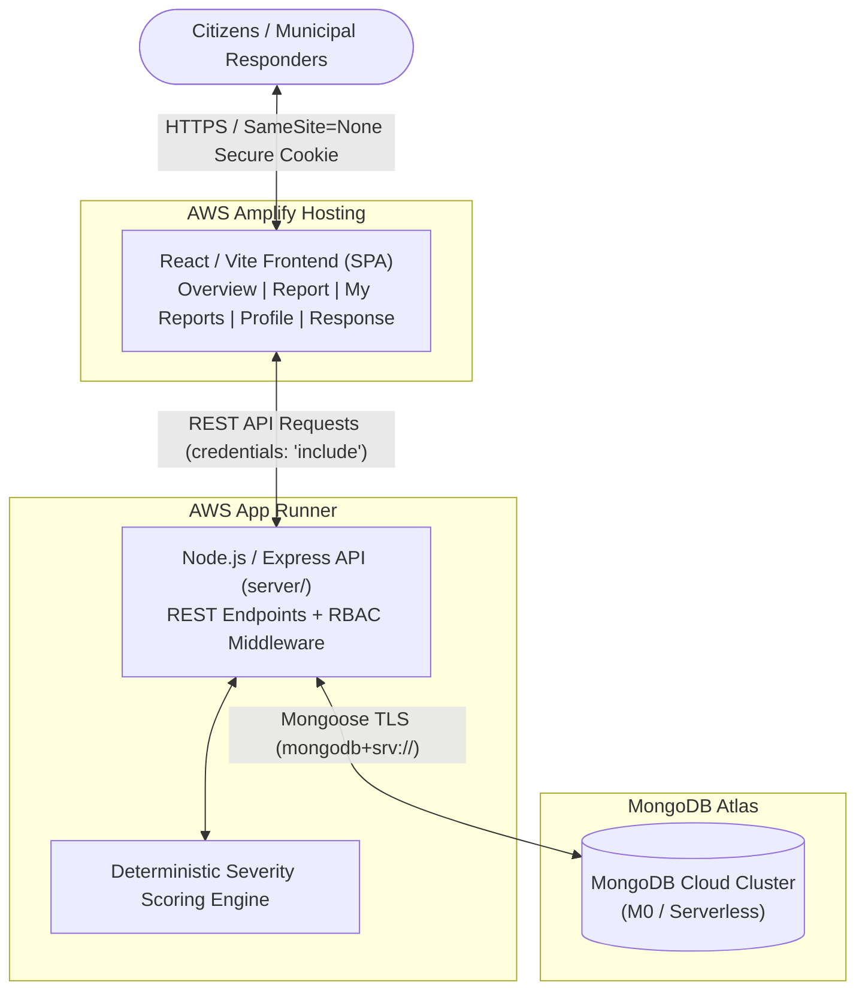

# FloodSignal Deployment Guide & Architecture

## 1. Architecture Diagram



---

## 2. Decoupled Service Overview

FloodSignal operates on a decoupled architecture separating static frontend assets from dynamic API execution and persistent database storage:

1. **Frontend (AWS Amplify Hosting):** Static single-page application built with Vite and React. Deployed globally via AWS's CloudFront CDN with automatic SSL/TLS.
2. **Backend (AWS App Runner):** Fully managed container/code runtime for the Express API rooted in `server/`. Scales compute automatically and exposes managed HTTPS endpoints.
3. **Database (MongoDB Atlas):** Managed cloud document database with automated backups, TLS encryption, and IP access control.

---

## 3. Environment Variables Reference

### Frontend Environment Variables (AWS Amplify Console)

Configured in **Amplify Console > App settings > Environment variables**:

| Variable       | Required | Description                                                          | Example Placeholder                                            |
| :------------- | :------: | :------------------------------------------------------------------- | :------------------------------------------------------------- |
| `VITE_API_URL` | **Yes**  | Fully qualified public HTTPS URL of your App Runner API `/api` root. | `https://<apprunner-service-id>.<region>.awsapprunner.com/api` |

> [!CAUTION]
> **Secret Hygiene:** Never define `JWT_SECRET`, database URIs, or provider credentials in the Amplify frontend environment. Any variable prefixed with `VITE_` is baked into public client-side JavaScript.

---

### Backend Environment Variables (AWS App Runner Console)

Configured in **App Runner Console > Configuration > Environment variables**:

| Variable                        |    Required    | Description                                                                                                                           | Example Placeholder                                                                                   |
| :------------------------------ | :------------: | :------------------------------------------------------------------------------------------------------------------------------------ | :---------------------------------------------------------------------------------------------------- |
| `JWT_SECRET`                    |    **Yes**     | Cryptographically secure string (minimum 32 characters) for signing session JWTs. The server terminates safely on startup if missing. | `<GENERATE_RANDOM_256_BIT_SECRET>`                                                                    |
| `MONGODB_URI`                   |    **Yes**     | MongoDB Atlas connection string with authenticated database username and password.                                                    | `mongodb+srv://<db-user>:<db-password>@<cluster>.mongodb.net/floodsignal?retryWrites=true&w=majority` |
| `ALLOWED_ORIGIN`                |    **Yes**     | Comma-separated list of allowed frontend domains for CORS with credentials.                                                           | `https://main.<amplify-app-id>.amplifyapp.com`                                                        |
| `PORT`                          |    **Yes**     | Port assigned by App Runner (set to `5001` or matching container port).                                                               | `5001`                                                                                                |
| `NODE_ENV`                      |    **Yes**     | Must be set to `production` to activate `Secure; SameSite=None` auth cookies and `trust proxy`.                                       | `production`                                                                                          |
| `STORAGE_DRIVER`                | **Yes** (Prod) | Storage driver: must be `s3` in production. Local disk is rejected on App Runner to prevent data loss.                                | `s3`                                                                                                  |
| `S3_BUCKET_NAME`                | **Yes** (Prod) | Dedicated S3 bucket for durable photo uploads.                                                                                        | `floodsignal-evidence-vault`                                                                          |
| `AWS_REGION`                    |       No       | AWS region for S3 bucket (defaults to `us-east-1` if omitted).                                                                        | `us-east-1`                                                                                           |
| `ALLOW_EPHEMERAL_LOCAL_STORAGE` |       No       | Emergency override only (`true`) for staging without S3.                                                                              | `false`                                                                                               |

---

## 4. Step-by-Step Production Deployment Guide

### Step 1: Create the MongoDB Atlas Production Database

1. Log in to [MongoDB Atlas](https://cloud.mongodb.com/).
2. Create a project and deploy a cluster (e.g., Free `M0` sandbox or Dedicated cluster).
3. **Database Access (Least-Privilege User):**
   - Navigate to **Security > Database Access > Add New Database User**.
   - Authentication Method: **Password**.
   - Assign user: e.g. `floodsignal_app`. Generate a strong 32+ character password.
   - Database User Privileges: Select **Built-in Role > Read and write to any database** (or restrict specifically to the `floodsignal` database).
4. **Network Access:**
   - Navigate to **Security > Network Access > Add IP Access List Entry**.
   - In AWS App Runner without VPC connectors, outbound IP addresses are dynamic. Add `0.0.0.0/0` (Allow Access from Anywhere) with description `App Runner Public Ingress`.
   - _Security Note:_ Access is protected by user authentication with SCRAM-SHA-256 and TLS.
5. **Retrieve Connection String:**
   - Click **Cluster > Connect > Drivers > Node.js**.
   - Copy connection string:
     `mongodb+srv://<db-user>:<db-password>@<cluster-endpoint>.mongodb.net/floodsignal?retryWrites=true&w=majority`

---

### Step 2: Deploy Express Backend to AWS App Runner

1. Open the [AWS App Runner Console](https://console.aws.amazon.com/apprunner).
2. Click **Create service**.
3. **Source and deployment:**
   - Source: **Source code repository**.
   - Connect your GitHub account and select the `Flood-Signal` repository.
   - Branch: `main`.
   - Deployment trigger: **Automatic** (or Manual).
4. **Build settings:**
   - Configuration file: **Configure all settings here**.
   - Runtime: **Nodejs 22** (Select `Nodejs 22` in App Runner runtime dropdown, or `Nodejs 20`).
   - Build command: `npm --prefix server install`
   - Start command: `node server/index.js`
   - Port: `5001`
5. **Service settings:**
   - Service name: `floodsignal-api`
   - CPU / Memory: `1 vCPU / 2 GB`
6. **Environment variables:**
   Add the following key-value pairs:
   - `NODE_ENV`: `production`
   - `PORT`: `5001`
   - `STORAGE_DRIVER`: `s3`
   - `S3_BUCKET_NAME`: `<YOUR_DEDICATED_S3_BUCKET_NAME>`
   - `AWS_REGION`: `us-east-1` (or your chosen AWS region)
   - `JWT_SECRET`: `<YOUR_SECURE_RANDOM_SECRET_MIN_32_CHARS>`
   - `MONGODB_URI`: `mongodb+srv://<db-user>:<db-password>@<cluster>.mongodb.net/floodsignal?retryWrites=true&w=majority`
   - `ALLOWED_ORIGIN`: `https://main.<amplify-app-id>.amplifyapp.com` _(Known after Step 3 Amplify creation)_
7. **Health check settings:**
   - Protocol: `HTTP`
   - Path: `/api/health`
   - Interval: `10` seconds, Timeout: `5` seconds, Healthy threshold: `1`, Unhealthy threshold: `3`.
8. Click **Create & deploy**.
9. Once deployed, copy your App Runner default service domain (e.g. `https://<service-id>.<region>.awsapprunner.com`).

---

### Step 3: Deploy Frontend to AWS Amplify Hosting

1. Open the [AWS Amplify Console](https://console.aws.amazon.com/amplify).
2. Click **Create new app > Host web app**.
3. Select **GitHub** and authorize AWS Amplify to access `Flood-Signal`.
4. Choose the repository and select branch `main`.
5. **Build settings:**
   - Amplify will automatically detect `amplify.yml`:
     ```yaml
     version: 1
     frontend:
       phases:
         preBuild:
           commands:
             - npm ci
         build:
           commands:
             - npm run build
       artifacts:
         baseDirectory: dist
         files:
           - "**/*"
       cache:
         paths:
           - node_modules/**/*
     ```
6. **Environment variables (Advanced settings):**
   - Key: `VITE_API_URL`
   - Value: `https://<service-id>.<region>.awsapprunner.com/api` (App Runner service domain + `/api`)
7. Click **Save and deploy**.
8. Once deployment completes, note your Amplify application domain:
   `https://main.<amplify-app-id>.amplifyapp.com`

---

### Step 4: Finalize CORS Cross-Origin Wiring

1. Return to the **AWS App Runner Console > floodsignal-api > Configuration > Environment variables**.
2. Update `ALLOWED_ORIGIN` to match your exact Amplify domain:
   ```
   ALLOWED_ORIGIN=https://main.<amplify-app-id>.amplifyapp.com
   ```
3. Click **Save changes** and allow App Runner to deploy the updated revision.

---

## 5. Post-Deployment Verification Checklist

Execute these verifications once both AWS services are active:

| Verification Target       | Action                                          | Expected Production Result                                                                                         |
| :------------------------ | :---------------------------------------------- | :----------------------------------------------------------------------------------------------------------------- |
| **API Health Check**      | Visit `https://<backend-url>/api/health`        | `200 OK` with `{"status":"ok","databaseConnected":true,"storageMode":"MongoDB"}`                                   |
| **Fail-Safe JWT Check**   | Inspect App Runner deployment log               | Server starts successfully only when `JWT_SECRET` is set.                                                          |
| **Frontend CDN Load**     | Open `https://main.<amplify-id>.amplifyapp.com` | Landing page renders, Leaflet tiles load, zero console build errors.                                               |
| **Citizen Registration**  | Register a new citizen account via UI           | `201 Created`, user profile displays, HttpOnly `token` cookie set with `Secure; SameSite=None`.                    |
| **Session Persistence**   | Refresh browser on `/overview`                  | User remains authenticated without logging out.                                                                    |
| **Incident Reporting**    | Submit a flood report via Report page           | Incident appears on the overview map and in `/my-reports`.                                                         |
| **Atlas DB Verification** | Check Atlas Collection `reports`                | Incident document saved with matching `authorId` and calculated priority.                                          |
| **Municipal Responder**   | Log in with authorized responder account        | Access granted to Dispatch Desk `/response`; status and verification toggle update live.                           |
| **Logout & Cookie Purge** | Click Log Out on Profile page                   | Session cookie cleared with matching `Secure; SameSite=None; expires=0` headers; protected routes reject requests. |
